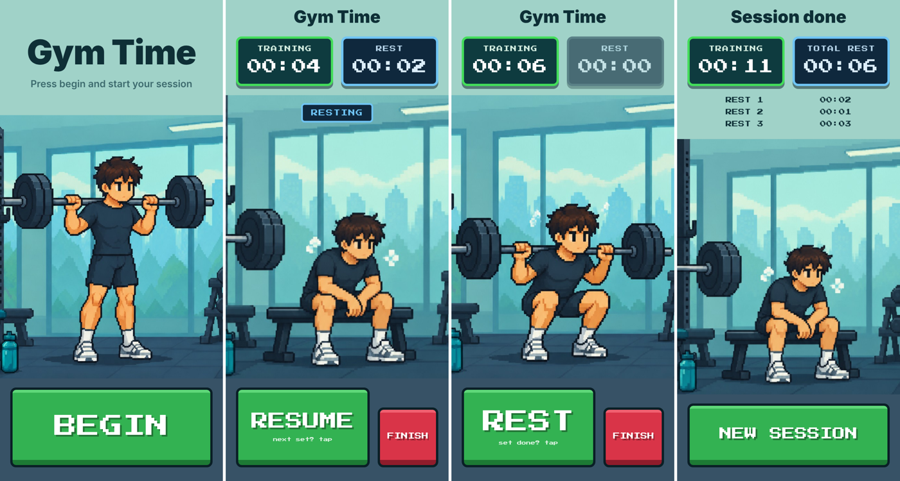

# Gym Time

An offline gym timer that splits every session into **training time** and **rest time**.

Tap the big green **BEGIN** to start. Tap **REST** when a set ends and **RESUME** when the next one starts. Tap **FINISH** twice when you're done to see your training time, total rest and each rest.



## MVP features

- One screen that changes with each button: Start → Training ⇄ Resting → Summary
- Big, high-contrast buttons sized for tired, sweaty hands
- Pixel-art lifter squats up and down while you train and sits on the bench while you rest (holds still if the phone's Reduce Motion is on)
- TRAINING counts from BEGIN to FINISH without pausing, rests included
- REST counts the current rest only; on RESUME that rest is recorded and the REST clock starts from 0 next time
- FINISH needs a second tap within 3 seconds, so a stray tap can't end a session
- Summary: training time, total rest time, and each rest listed (Rest 1, Rest 2, …)
- Haptic feedback on every tap; the screen stays on during a session
- Works fully offline, with no account

## Run it on your phone

1. Install [Node.js](https://nodejs.org) (version 20 or newer).
2. Install **Expo Go** on your phone from the App Store or Google Play.
3. In this folder, run:

   ```bash
   npm install
   npx expo start
   ```

4. Scan the QR code. On iPhone use the Camera app; on Android, use Expo Go's scanner. Your phone and computer must be on the same Wi-Fi.

To try it in a browser instead, press `w` after `npx expo start`.

## Scripts

| Command | What it does |
| --- | --- |
| `npm start` | Start the dev server |
| `npm test` | Run the unit tests (Jest) |
| `npm run typecheck` | TypeScript check |
| `npm run lint` | ESLint with Expo's rules |

## How it works

| File | Role |
| --- | --- |
| `src/session.ts` | Session logic as a pure reducer (a state machine), with no UI code |
| `src/GymTimeScreen.tsx` | The single screen; shows the right buttons and clocks for each state |
| `src/components/PixelButton.tsx` | The chunky pixel-style button that sinks when pressed |
| `src/components/TimerCard.tsx` | A TRAINING or REST clock card |
| `src/components/GymScene.tsx` | The lifter picture: stand, squat or sit on the bench, by state |
| `src/__tests__/` | 24 unit tests for the timer logic and the lifter's poses |

**Timestamps, not tick counting.** Each tap stores the exact time it happened, and the totals are calculated from those timestamps. A 250 ms interval only redraws the screen. So the clocks stay accurate even if the phone lags. Each rest is cut to whole seconds when it's recorded, so the listed rests always add up to the total rest shown.

## Built with

Expo SDK 57 (matches the App Store Expo Go) · React Native 0.86 · TypeScript · Jest · Press Start 2P font

## Next (after MVP)

From the PRD: saving sessions to the calendar, session history, timers that keep running while the app is in the background, a rest-target alert, per-set breakdown, and lock-screen controls.
