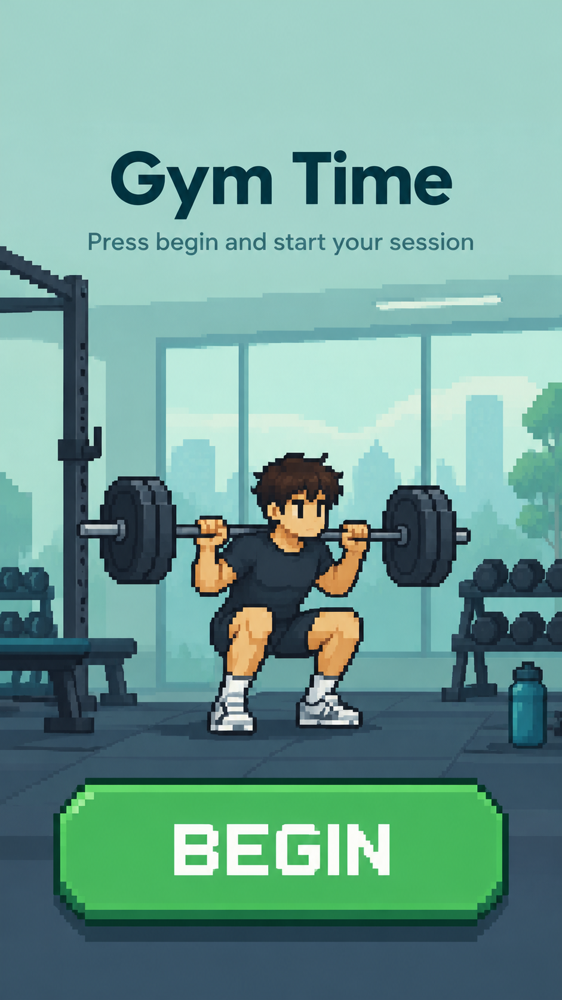
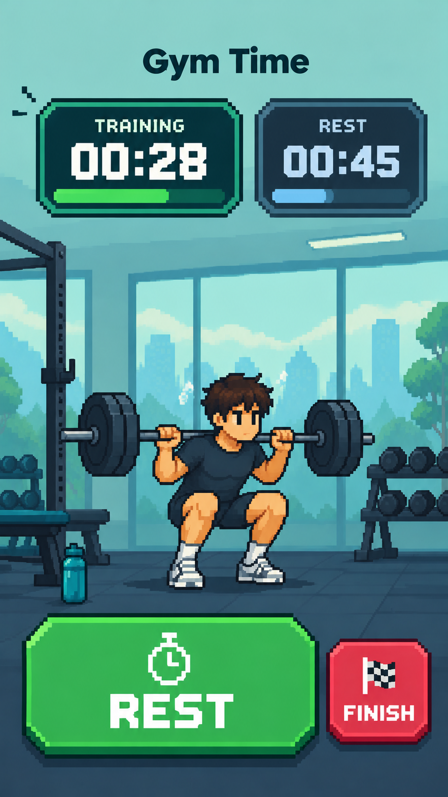
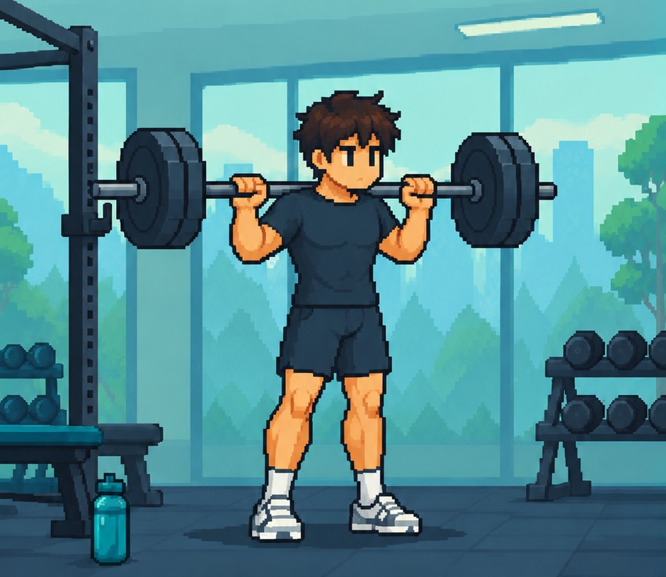

# Gym Session & Rest Timer — PRD

Oct 22, 2026 · Victor

## Background

Daily gym-goers time their sessions on their phones, but a plain clock or stopwatch only tells them how long they have been in the gym. The founder of this idea trains every day and uses the phone's clock to see how long each workout runs.

## Problem statement

The phone clock tracks total workout time but has no way to track rest time between sets. Lifters need one app where they press a button when training starts and a separate button when they rest between sets.

Today this means juggling a stopwatch and a countdown timer, or guessing rest time. As a result, users cannot see how much of a session was actual training versus rest.

## User personas

The primary user is a tired lifter mid-workout who needs to read and tap the screen in under two seconds.

| Persona | Who they are | What they need |
| --- | --- | --- |
| Daily lifter | Trains 5–7 days a week, sweaty hands, short on breath between sets | Big buttons, readable at arm's length, one tap to switch between training and rest |
| Casual gym-goer | Trains 2–3 times a week, less structured routine | Simple start/stop with no setup or account required |

Design implications: high-contrast screen, large tap targets, minimal text, and no menus during a session.

## Solution and impact

An offline mobile app with a big green BEGIN button, a big REST button and a FINISH button; it tracks training and rest separately, saves each session to the calendar and shows the split at the end.

How a session works:

1. Tap the big green **BEGIN** button; the session clock and the training clock start.
2. Finish a set and tap the big **REST** button; the rest clock starts from 00:00 and the training clock keeps running.
3. Tap **RESUME** (the same big button) to start the next set; that rest's length is recorded and the rest clock resets to 00:00.
4. Repeat steps 2–3 for every set.
5. Tap **FINISH**; the session is saved to the calendar and the summary shows total time, training time, rest time and number of rest periods.

Impact: the user knows exactly how much of each session went to training versus rest. This helps them keep rest consistent, cut wasted time, and spot sessions that ran long.

## UI design

The app uses a pixel-art gym theme in teal and dark slate, with one large action button at the bottom of each screen.

| Begin screen | During session |
| --- | --- |
|  |  |
| Title, one-line prompt and a full-width green **BEGIN** button | **TRAINING** and **REST** timers side by side; big **REST** button; smaller red **FINISH** button |

### Lifter animation

The pixel-art lifter in the middle of the screen shows the current mode at a glance: he squats while you train and sits on the bench while you rest.

| Standing | Squatting | Sitting on the bench |
| --- | --- | --- |
|  |  |  |

| Screen state | What the lifter does |
| --- | --- |
| Start (before BEGIN) | Stands still with the bar |
| Training | Squats: switches between standing and squatting every 0.9 s; each set starts from standing |
| Resting | Sits on the bench, still |
| Summary (after FINISH) | Sits on the bench, still |

- All three pictures share the same background and camera, so only his body moves (the bench picture is slightly more zoomed in).
- If the phone's Reduce Motion setting is on, he holds the squat pose instead of moving.

Open questions from the mock-ups:

- The REST button is green, the same as BEGIN; should it change color (e.g. blue, matching the rest timer) so the current mode is obvious at a glance?
- Timers show mm:ss; sessions over an hour need h:mm:ss.
- The summary screen after FINISH is not designed yet.

## MVP scope

The MVP is one screen that changes state with each button tap:

1. **Start:** a big green BEGIN button.
2. **Training:** a live training timer that runs from BEGIN to FINISH without pausing, a big REST button, plus FINISH.
3. **Resting:** a live timer for the current rest (starts at 00:00 each time) and a big RESUME button, plus FINISH. The training timer keeps running.
4. **Summary (after FINISH):** training time, total rest time, and each rest listed (Rest 1, Rest 2, …).

Calendar saving, history and the other extras come after the MVP.

## Functional requirements

The first release must let a user run one session with separate training and rest clocks and see the split at the end.

| ID | Requirement | Release |
| --- | --- | --- |
| F1 | Big green **BEGIN** button starts the session and the training timer | MVP |
| F2 | Big **REST** button starts the rest timer from 00:00 (training keeps running); the same button reads **RESUME** to switch back | MVP |
| F3 | **FINISH** button ends the session (with a confirm step to prevent accidental taps) | MVP |
| F4 | Show the training timer (BEGIN to FINISH, never pauses) and the current rest timer live | MVP |
| F6 | End-of-session summary: training time, total rest time, and each rest listed; show at least 20 rests without scrolling (two columns of 10), scroll for more | MVP |
| F12 | Record each rest period; on RESUME the rest timer restarts from 0 | MVP |
| F5 | On FINISH, record the session to the calendar: date, start/end time, training time, rest time | Later |
| F7 | Timers keep running when the screen locks or the app goes to background | Later |
| F8 | Calendar view in the app to open any past day's session summaries | Later |
| F9 | Optional rest target (e.g. 90 s) with vibration or sound when it is reached | Later |
| F10 | Per-set breakdown in the summary (length of each set and each rest) | Later |
| F11 | Lock-screen or notification controls for REST/RESUME | Later |

## Non-functional requirements

The app must be readable and usable by an exhausted person with one sweaty hand.

| Area | Requirement |
| --- | --- |
| Usability | BEGIN and REST buttons cover at least a third of the screen; BEGIN is green, REST a distinct color; any core action takes one tap |
| Readability | Timer digits readable at arm's length (about 60 cm); high-contrast colors, distinct color for Train vs Rest |
| Accuracy | Timers drift less than 1 second per hour, including in background |
| Reliability | No session data lost if the app is closed, the phone locks or a call comes in |
| Performance | App opens to the start screen in under 2 seconds; button response under 100 ms |
| Battery | Under 5% battery used per 1-hour session with the screen off |
| Offline | Works fully without internet, including calendar saving (stored on the device); no account needed |
| Platforms | iOS and Android phones |
| Privacy | Session data stays on the device unless the user chooses to export it |

## FAQs

**What happens if I forget to tap Rest?** That time counts as training. In a later version, the user can edit the summary to correct it.

**Does the timer keep running if I lock my phone or switch apps?** Yes. Timers are based on start timestamps, so they stay accurate in the background.

**Do I need an account or internet?** No. Everything works offline and is stored on the phone.

**Can I set a rest countdown, like 90 seconds?** Yes, as an optional rest target that alerts with vibration or sound. Rest time is still recorded if you go over.

**How is this different from a normal stopwatch?** A stopwatch gives one number. This app splits the session into training and rest and shows both at the end.

**Will it log exercises, weights or reps?** Not in the first version. The focus is time tracking; exercise logging could come later.

**Where do my sessions go after I tap FINISH? Can I see past sessions?** In the MVP, FINISH shows that session's total training and rest time. Saving sessions to the calendar and browsing past days come in a later release.

**What if I tap FINISH by accident?** A quick confirm step appears first, so a stray tap won't end the session.
